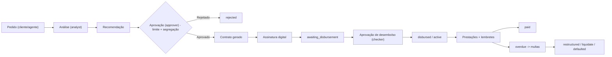

# 📘 CrediSmart+ / TaquiMola — Documento de Funcionalidades

> **Versão:** levantamento de 27/10/2026 · **Fonte:** análise directa do código-fonte (`backend`, `admin-web`, `mobile-app`)
> Este documento descreve o que **está implementado hoje**, e não o roadmap. Os itens parciais ou ainda por ligar estão assinalados na secção [Lacunas e Pontos de Atenção](#9-lacunas-e-pontos-de-atenção).

---

## Índice

1. [Visão Geral e Arquitectura](#1-visão-geral-e-arquitectura)
2. [Perfis de Utilizador e Controlo de Acessos](#2-perfis-de-utilizador-e-controlo-de-acessos)
3. [Painel Administrativo Web](#3-painel-administrativo-web-admin-web)
4. [Aplicação Móvel](#4-aplicação-móvel-mobile-app)
5. [Backend — API REST](#5-backend--api-rest)
6. [Ciclo de Vida do Crédito](#6-ciclo-de-vida-do-crédito)
7. [Automação e Jobs Agendados](#7-automação-e-jobs-agendados)
8. [Integrações Externas](#8-integrações-externas)
9. [Lacunas e Pontos de Atenção](#9-lacunas-e-pontos-de-atenção)

---

## 1. Visão Geral e Arquitectura

Plataforma **SaaS multi-tenant** para gestão do ciclo completo de microcrédito: registo e KYC do cliente, simulação, pedido, análise, aprovação, contrato, desembolso, cobrança e relatórios regulatórios.

| Componente | Tecnologia | Função |
|---|---|---|
| `backend` | Node.js, Express, MongoDB (Mongoose) | API REST, regras de negócio, jobs, integrações |
| `admin-web` | React (Vite), Recharts, jsPDF, xlsx, i18next | Painel para Owner, gestores, agentes e Super Admin |
| `mobile-app` | React Native (Expo) | App para Clientes e Agentes de campo |

**Multi-tenancy**
- Um **Owner** pode criar e gerir **várias instituições** e alternar entre elas (`InstitutionSwitcher`).
- Os dados são isolados por instituição (`institution` em todos os modelos principais).
- O **Super Admin** gere todas as instituições, as subscrições e os pedidos de plano.

**Modelos de dados (21):** User, Role, Institution, Credit, Installment, Payment, Contract, ContractTemplate, Document, Simulation, Commission, AgentTarget, CashTransaction, AuditLog, Notification, CommunicationTemplate, MessageSchedule, SmsLog, WhatsAppLog, WhatsAppTemplate, SubscriptionRequest.

---

## 2. Perfis de Utilizador e Controlo de Acessos

### 2.1 Roles nativas

| Role | Descrição resumida |
|---|---|
| `super_admin` | Acesso universal (`*`). Gere instituições e subscrições da plataforma. |
| `owner` | Dono da(s) instituição(ões). Acesso total à sua instituição, incluindo configurações e roles. |
| `admin` | Administração operacional: clientes, créditos (até aprovar), pagamentos, utilizadores e auditoria. |
| `manager` | Gestão de clientes, créditos, pagamentos, cobranças e relatórios. |
| `supervisor` | Análise, recomendação e aprovação de créditos. Relatórios. |
| `analyst` | Analisa e recomenda créditos. |
| `approver` | Aprova ou rejeita créditos. |
| `financial` | Desembolso, pagamentos e conciliação. |
| `collector` | Carteira de cobranças, contactos, renegociação e recebimentos. |
| `agent` / `representative` | Agente de campo: regista clientes e cria pedidos de crédito. |
| `support` | Consulta de clientes, créditos e pagamentos. |
| `auditor` | Leitura de tudo, exportação e audit logs. |
| `client` | Área do cliente (app móvel). |

### 2.2 RBAC granular ([rbac.js](backend/src/middleware/rbac.js))
- **Catálogo de permissões** com 7 módulos: Clientes, Créditos, Pagamentos, Cobranças, Relatórios, Utilizadores/Roles e Auditoria/Configurações.
- **Roles personalizadas** (`Role`) criadas pelo Owner, com permissões e **limite de aprovação** próprios.
- Wildcards por módulo (ex.: `creditos.*`).
- **Segregação de funções (Maker-Checker):** quem cria ou analisa um pedido **não o pode aprovar**.
- **Limite de aprovação por valor:** se o montante ultrapassar o limite do utilizador ou da role, o pedido tem de subir para aprovação superior.
- No frontend: `PermissionGuard`, o hook `usePermissions` e um menu lateral filtrado por role e por permissão.

### 2.3 Autenticação e segurança
- Login com **JWT + Refresh Token**, logout e endpoint `/me`.
- **Autenticação de dois factores (2FA/TOTP)** com geração de QR, activação e desactivação (`TwoFactorSetup`).
- Recuperação de palavra-passe por email (forgot/reset com token).
- Eliminação da própria conta (`DELETE /auth/me`).
- Registo de **push token** do dispositivo.
- **Auditoria** das acções críticas por middleware (`auditAction`), com nível de severidade (low/medium/high/critical).
- Bloqueio do acesso quando a subscrição da instituição expira (excepto para o Super Admin).

---

## 3. Painel Administrativo Web (`admin-web`)

### 3.1 Páginas públicas
| Rota | Funcionalidade |
|---|---|
| `/` , `/landing` | Landing page comercial da plataforma |
| `/login` | Login (com suporte a 2FA) |
| `/forgot-password`, `/reset-password/:token` | Recuperação de palavra-passe |
| `/register-owner` | Registo self-service de Owner com a sua instituição e escolha de plano |
| `/privacy` | Termos legais e política de privacidade |

### 3.2 Principal
| Menu | Rota | Funcionalidades |
|---|---|---|
| **Global View** | `/global-dashboard` | Métricas consolidadas de todas as instituições do Owner |
| **Dashboard** | `/dashboard` | KPIs da carteira, gráficos, receita e alertas |
| **Caixa** | `/cashflow` | Saldo inicial, entradas e saídas manuais (CRUD), saldo diário e resumo de tesouraria |
| **Clientes** | `/clients`, `/clients/new`, `/clients/:id` | Lista e pesquisa, onboarding multi-passo, perfil completo (dados, documentos, histórico de créditos, score de confiança, verificação e bloqueio, histórico de alterações) |
| **Pedido de Crédito** | `/clients/:clientId/request-credit` | Pedido assistido com simulador financeiro, garantias e fotos |
| **Documentos** | `/pending-documents` | Fila de validação de documentos KYC (aprovar ou rejeitar, visualizar, descarregar) |
| **Empréstimos** | `/loans`, `/credits/:id` | Lista com filtros por estado; detalhe com workflow (analisar → recomendar → aprovar → desembolsar), plano de prestações, marcar prestação paga/pendente, contrato, reestruturação, liquidação antecipada, garantias e histórico |
| **Contratos** | `/contract-templates` | Editor de modelos de contrato com variáveis dinâmicas |
| **Cobranças** | `/payments` | Lista de pagamentos, comprovativos, confirmação e rejeição de pagamentos pendentes |

### 3.3 Relatórios
| Menu | Rota | Funcionalidades |
|---|---|---|
| **Relatórios** | `/reports` | Performance de créditos, análise de incumprimento, resumo financeiro, estatísticas de clientes, métricas de aprovação, funil de onboarding e performance de agentes |
| **Rel. Mensal** | `/reports/monthly` | Relatório mensal, com exportação para Excel |
| **Rel. Trimestral** | `/reports/quarterly` | Relatório trimestral consolidado |
| **Rel. BdM** | `/reports/bom` | Relatório regulatório para o **Banco de Moçambique**, com exportação para Excel |
| **Comissões** | `/commissions` | Configuração, cálculo por período, aprovação e pagamento de comissões |
| **Meus Ganhos** | `/my-commissions` | Comissões e metas do próprio agente |

### 3.4 Comunicação
| Menu | Rota | Funcionalidades |
|---|---|---|
| **Dashboard** | `/communication` | Estatísticas de envios por canal e estado |
| **Conexão WhatsApp** | `/whatsapp-settings` | Ligação por QR Code (whatsapp-web.js), estado, reinício, desligar e mensagem de teste |
| **Enviar** | `/communication/send` | Envio imediato ou agendado (WhatsApp/SMS/Email) para clientes |
| **Agendamentos** | `/communication/schedules` | Fila de mensagens pendentes |
| **Templates** | `/communication/templates` | Modelos de mensagem com variáveis (`{name}`, `{amount}`, `{date}`…) |
| **Histórico** | `/communication/history` | Registo completo de mensagens enviadas e falhadas |

### 3.5 Sistema
| Menu | Rota | Funcionalidades |
|---|---|---|
| **Utilizadores** | `/users`, `/users/new`, `/users/:id` | CRUD de utilizadores da instituição, atribuição de role e limite de aprovação |
| **Perfis & Permissões** | `/roles` | Criação de roles personalizadas a partir do catálogo de permissões |
| **SMS Logs** | `/sms-logs` | Logs e estatísticas de SMS |
| **Auditoria** | `/audit-logs` | Pesquisa e filtro de audit logs; histórico por entidade |
| **Performance** | `/agent-performance` | Ranking e métricas por agente |
| **Minha Subscrição** | `/my-subscription` | Plano actual, dias restantes e pedido de renovação ou upgrade |
| **Configurações** | `/settings` | Dados da instituição, logótipo, cor, limites de crédito, taxas de juro e de mora, contas de pagamento (banco/M-Pesa/e-Mola), garantias, regras de lembretes, requisitos de onboarding e assinatura/carimbo |
| **Estado do Sistema** | `/system-status` | Health check (BD, serviços) |
| **Nova Instituição** | `/institutions/new` | Onboarding de mais uma instituição pelo Owner |

### 3.6 Super Admin
| Menu | Rota | Funcionalidades |
|---|---|---|
| **Dashboard Global** | `/global-dashboard` | Visão de toda a plataforma |
| **Instituições** | `/institution-management` | Gestão de tenants, planos, estados e pedidos de subscrição (com contador de pendentes) |

### 3.7 Componentes transversais
- **Tema claro/escuro** (`ThemeContext`) e i18n (PT).
- `FinancialSimulator`: simulador Price/SAC/Flat, com exportação para PDF.
- `ContractViewer` + `SignatureModal`: visualização e assinatura manuscrita do contrato pelo agente.
- `ConfidenceIndicator`: score de risco de 0 a 1000 com 5 níveis.
- `EntityHistory`: linha temporal de auditoria por entidade.

---

## 4. Aplicação Móvel (`mobile-app`)

A navegação muda conforme o perfil autenticado.

### 4.1 Autenticação
- **Login** e **Registo** de cliente, com escolha da instituição (lista pública de instituições premium).
- Push notifications (Expo/Firebase), com registo de token no backend.

### 4.2 Área do Cliente
| Ecrã | Funcionalidades |
|---|---|
| **Início** | Resumo dos créditos, próxima prestação com contagem decrescente, notificações, atalhos para documentos, assinatura de contrato e simulador |
| **Simular** | Simulador de crédito (valor, prazo, periodicidade) com total a pagar e prestação |
| **Solicitar Crédito** | Pedido a partir da simulação: finalidade, garantias com fotos e aceitação de termos |
| **Créditos** | Lista dos meus créditos e respectivo estado |
| **Detalhes do Crédito** | Saldo devedor, próxima prestação e acesso ao pagamento, calendário e histórico |
| **Calendário de Prestações** | Lista de prestações com estado e botão para pagar |
| **Pagar Prestação** | Registo de pagamento com envio de comprovativo |
| **Histórico de Pagamentos** | Pagamentos efectuados |
| **Documentos** | Upload de documentos KYC (câmara ou ficheiro) e estado de validação |
| **Assinar Contrato** | Assinatura digital do contrato |
| **Perfil** | Dados pessoais, acesso a documentos e contrato, logout e eliminação da conta |

### 4.3 Área do Agente de Campo
| Separador | Funcionalidades |
|---|---|
| **Início** | Painel do agente |
| **Novo Cliente** | Registo de cliente no terreno |
| **Cobranças** | Lista de créditos em atraso e registo de pagamentos recebidos |
| **Perfil** | Dados do agente |

### 4.4 Fluxo KYC multi-passo (implementado, não ligado — ver §9)
Dados Pessoais → Documento de Identidade → Prova de Vida (liveness) → Morada → Informação Profissional → Informação Financeira → Dados Bancários e Assinatura.

---

## 5. Backend — API REST

Base: `/api`. A tabela resume os endpoints por módulo.

| Módulo | Prefixo | Endpoints principais |
|---|---|---|
| Auth | `/auth` | register, login, refresh, me (GET/DELETE), forgot/reset-password, logout, users, push-token, 2fa (generate/enable/disable) |
| Clientes | `/clients` | CRUD, upload de documentos (pelo staff e pelo próprio cliente), verificar e bloquear cliente, verificar documento |
| Instituições | `/institutions` | criar, public, all, switch/:id, my (GET/PUT), my/logo, stats/global, subscription-requests |
| Créditos | `/credits` | simulate (+pdf), request, listar, **overdue (carteira de cobranças)**, detalhe, analyze, recommend, approve, reject, disburse, approve-disbursement, insist, generate/sign/approve/reject-contract, toggle-status de prestação, restructure, liquidate, fotos de garantias |
| Simulações | `/simulations` | guardar simulação, PDF, envio por WhatsApp, histórico |
| Contratos | `/contracts` | gerar, enviar para assinatura, obter por crédito, assinatura do agente, webhook de assinatura |
| Modelos de contrato | `/contract-templates` | CRUD |
| Pagamentos | `/payments` | registar com comprovativo, pendentes, confirmar, rejeitar, listar, detalhe |
| Caixa | `/cashflow` | resumo, saldo inicial, transacções (CRUD), saldo diário |
| Documentos | `/documents` | pendentes, verificar, download e visualização segura |
| Score | `/confidence` | calcular e consultar o score de um cliente |
| Comissões | `/commissions` | listar, minhas comissões, resumo por período, calcular, aprovar, pagar, performance do agente, minhas metas |
| Relatórios | `/reports` | credit-performance, default-analysis, financial-summary, client-statistics, approval-metrics, onboarding-funnel, agent-performance, monthly, quarterly, bom, exportações Excel |
| Analytics | `/analytics` | dashboard, portfolio, revenue, global |
| Comunicação | `/communication` | send, schedule, history, stats, templates |
| WhatsApp | `/whatsapp` | status/QR, templates, restart, disconnect, send |
| SMS | `/sms` | logs, stats |
| Notificações | `/notifications` | listar, marcar uma como lida, marcar todas como lidas |
| Utilizadores | `/users` | CRUD (auditado) |
| Roles | `/roles` | catálogo de permissões e CRUD |
| Auditoria | `/audit` | logs e histórico por entidade |
| Health | `/health` | estado do sistema |

### 5.1 Motores de negócio
- **Simulação financeira** ([simulationService.js](backend/src/services/simulationService.js)): amortização **Price, SAC, Simples, Composto e Flat**; periodicidade diária, semanal, quinzenal ou mensal; período de carência. É a mesma matemática para a BD, o PDF e a UI.
- **Score de confiança** ([confidenceService.js](backend/src/services/confidenceService.js)): escala de 0 a 1000 que pondera fidelidade, volume pago, dias de atraso e taxa de incumprimento. Daí resultam 5 níveis (Muito Arriscado → Muito Confiável) e uma recomendação automática (APPROVE/REVIEW/WARN/REJECT) com multiplicador de montante e desconto de juro.
- **Contratos** ([contractService.js](backend/src/services/contractService.js)): geração de PDF (pdfkit) a partir de templates, com dados da instituição, assinatura/carimbo e metadados da assinatura (IP, user-agent, método OTP/manuscrita/confirmação).
- **Numeração de crédito:** `LOAN-AAAAMM-NNNN-XXXX`.
- **Comissões e metas:** metas mensais por agente (novos clientes, créditos aprovados, valor desembolsado e taxa de cobrança), com bónus e percentagem de conclusão.

---

## 6. Ciclo de Vida do Crédito

- **Estados:** draft, submitted, pending, under_analysis, waiting_documents, recommended, approved, rejected, awaiting_disbursement, disbursed, active, paid, overdue, defaulted, restructured, cancelled, uncollectible.
- **Histórico do workflow** registado por etapa (quem, quando, comentário).
- **Garantias:** veículo, imóvel, fiador, equipamento ou outra, com valor, fotos e documentos.
- **Desembolso:** M-Pesa (payout B2C automático na aprovação do desembolso), e-Mola ou transferência bancária (registo manual), com acção "insistir" quando a contagem decrescente expira.
- **Reestruturação** de prazos e valores, e **liquidação antecipada** com perdão dos juros futuros.

---

## 7. Automação e Jobs Agendados

| Job | Frequência | Função |
|---|---|---|
| `cronService.dailyJob` | Diário, 08:00 | Calcula a **multa de mora** (taxa da instituição × dias de atraso), marca prestações `overdue`, envia lembretes (D-7/-3/-1, dia do vencimento, D+1/+3/+7) por push e pela fila, e **expira subscrições** |
| `cronService.queueJob` | A cada minuto | Processa a fila de mensagens (`MessageSchedule`) |
| `messageQueueJob` | A cada minuto | Processa a fila de mensagens (duplicado — ver §9) |
| `automatedRemindersJob` | Diário, 09:00 | Lembretes automáticos D-3, D-1, D0, D+1, D+3 e D+7 |
| `whatsappJobs` | Diário, 09:00 | Envios por `WhatsAppTemplate` com gatilho before_due, on_due_date ou after_due |
| Seed de templates | No arranque | Cria os templates de comunicação por defeito |

---

## 8. Integrações Externas

| Integração | Estado | Detalhe |
|---|---|---|
| **WhatsApp** (whatsapp-web.js) | ✅ Activa | Sessão por QR, envio de mensagens e de PDFs de simulação |
| **SMS** | ✅ Activa | Usado em créditos, pagamentos e na fila de comunicação; com logs |
| **Email** (nodemailer) | ✅ Activa | Recuperação de palavra-passe e notificações de crédito |
| **Push** (Firebase Admin / Expo) | ✅ Activa | Lembretes e alertas no dispositivo |
| **PDF** (pdfkit / jsPDF) | ✅ Activa | Contratos, simulações e relatórios |
| **Excel** (xlsx) | ✅ Activa | Relatório mensal e relatório BdM |
| **2FA** (speakeasy + qrcode) | ✅ Activa | TOTP |
| **Cloudinary / Multer** | ✅ Activa | Upload de documentos, comprovativos, logótipos e fotos de garantias |
| **M-Pesa B2C** (desembolso) | ✅ Activa | `mpesaService.executeMpesaPayout` usado em `credits.js` na aprovação do desembolso |
| **M-Pesa C2B / e-Mola** (recebimentos) | ⚠️ Serviços criados, não ligados | `mpesa.js` e `emola.js` não são importados por nenhuma rota |

---

## 9. Lacunas e Pontos de Atenção

Pontos encontrados durante o levantamento. Convém revê-los antes de dar o produto como "100% funcional".

| # | Área | Observação |
|---|---|---|
| 1 | Pagamentos | **Recebimentos por M-Pesa/e-Mola não integrados**: os pagamentos dos clientes são manuais, com comprovativo e confirmação pelo staff. O desembolso por M-Pesa B2C já está integrado. |
| 2 | Segurança | ~~`helmet` e `express-rate-limit` inativos~~ ✅ **Resolvido** (27/10/2026): Helmet ativado (com suporte a iframes de documentos) e rate limit global (500 req/15min) + auth (100 req/15min). |
| 3 | Comunicação | ~~Fila de mensagens processada duplamente~~ ✅ **Resolvido** (27/10/2026): removido o worker concorrente redundante (`messageQueueJob`), mantendo a gestão centralizada via `cronService.queueJob`. |
| 4 | Comunicação | Há três mecanismos de lembretes sobrepostos (cronService às 08:00, automatedRemindersJob e whatsappJobs às 09:00): o cliente pode receber lembretes repetidos. |
| 5 | Menu web | ~~Role `'manager'` corrompido em `Sidebar.jsx`~~ ✅ **Resolvido** (27/10/2026) |
| 6 | Mobile | ~~Ecrã Cobranças chamava `GET /credits/overdue` inexistente~~ ✅ **Resolvido** (27/10/2026): rota criada e o ecrã passou a usar o valor em dívida real e a prestação mais antiga. |
| 7 | Mobile | O **fluxo KYC multi-passo** (incl. prova de vida) não está registado no `AppNavigator`, por isso não é acessível. |
| 8 | Backend | Rotas duplicadas em `credits.js` (`PUT /:id/reject` e `PUT /:id/disburse`): só a primeira definição é usada. |
| 9 | Backend | ~~Módulo Ordens de Entrega (`/delivery-orders`) desnecessário~~ ✅ **Removido** (27/10/2026): rotas, controladores e modelos (`DeliveryOrder`, `DeliveryStop`) removidos do projeto. |
| 10 | Configuração | `notificationSettings.channels` no modelo `Institution` não tem `whatsapp`, mas o cronService depende desse campo. |
| 11 | Repositório | Há muitos scripts de teste/fix soltos na raiz de `backend/` (`test_*.js`, `fix_*.cjs`, `check_*.js`) e uma chave Firebase Admin versionada. |
